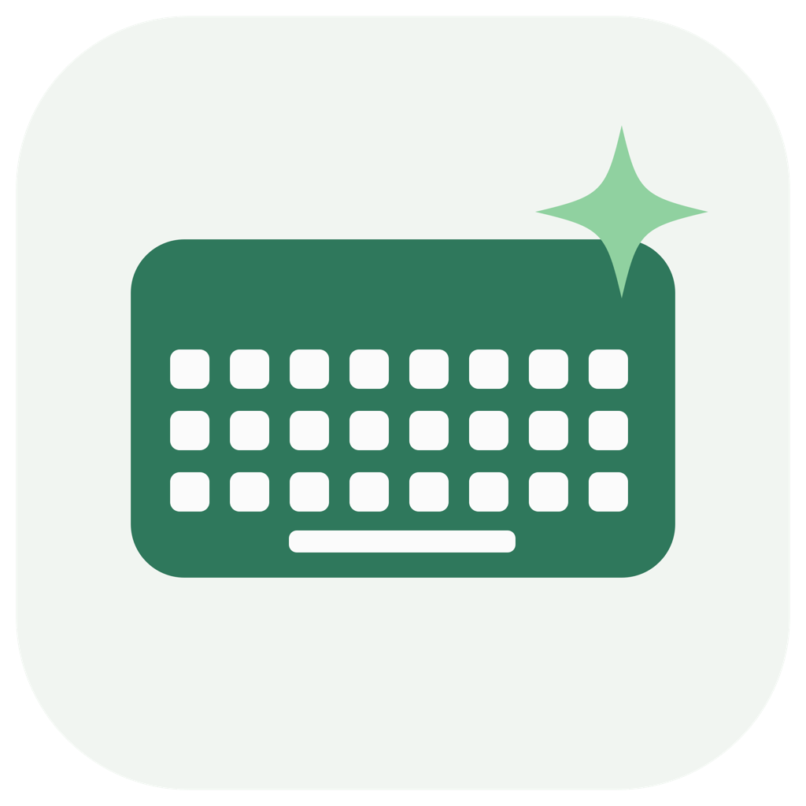
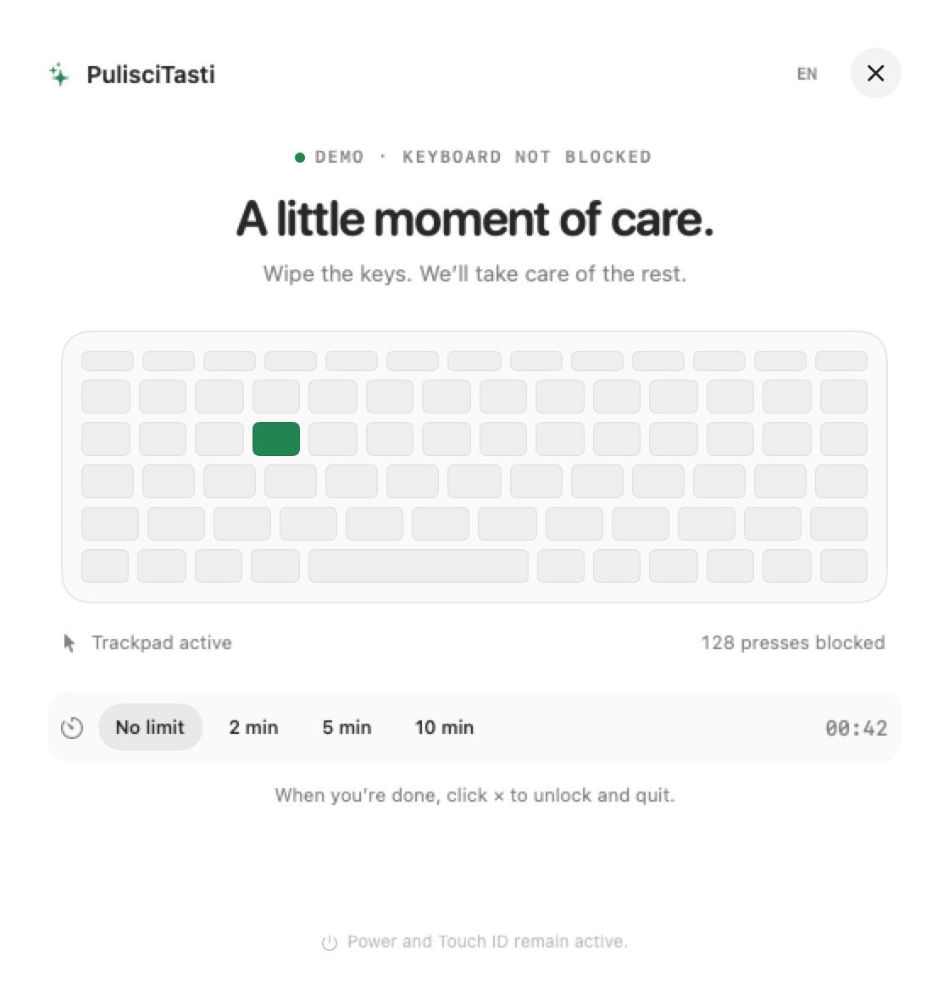

<p align="center"></p>
<h1 align="center">PulisciTasti</h1>
<p align="center">A little moment of care for your Mac.<br>Lock your keyboard. Keep your trackpad. Wipe away.</p>
<p align="center"><a href="https://github.com/nloris/PulisciTasti/releases/latest">Download</a> · <a href="LEGGIMI.md">Italiano</a> · <a href="#build-from-source">Build from source</a></p>



PulisciTasti is a small native macOS utility for cleaning your keyboard. Opening the app blocks keyboard events across apps, while your mouse and trackpad stay available. Click **×** to unlock and quit.

This is a keyboard lock for physical cleaning, not a disk cleaner or a security lock screen.

## Features

- One-step keyboard lock after Accessibility permission has been granted.
- A live keyboard illustration and a session-only blocked-key counter.
- Optional automatic unlock after 2, 5 or 10 minutes. **No timer by default.** Selecting a duration starts a fresh countdown.
- Elapsed time, countdown, and a clear unlocked state when the timer finishes.
- Light and dark appearance following macOS, plus an Italian/English switch.
- A menu bar button that also unlocks and quits.
- No account, analytics, network access, or third-party runtime dependencies.

## Install and use

Requires **macOS 13+**. The app is a universal binary for Apple Silicon and Intel; direct hardware testing so far has been on Apple Silicon.

1. Download the ZIP from [Releases](https://github.com/nloris/PulisciTasti/releases/latest) and extract it, or build from source below.
2. Move `PulisciTasti.app` to the location where you want to keep it before granting permission.
3. Open the app and click **Open Accessibility**. In System Settings → Privacy & Security → Accessibility, enable PulisciTasti. Add it with **+** if it is not listed.
4. Return to the app. Start cleaning only when it says **KEYBOARD LOCKED**. If macOS has not picked up the permission, quit and reopen.
5. Click **×**, or the keyboard icon in the menu bar, to unlock and quit.

**Distribution status:** this release is signed ad hoc for local use, not signed with a Developer ID or notarized by Apple. macOS may block a downloaded copy. Building locally is the recommended option for this early release. A rebuilt or moved app may need Accessibility permission granted again.

## What is and is not blocked

The filter suppresses keyboard-down, keyboard-up, modifier, and system-defined events delivered through a Quartz HID event tap. Mouse clicks, movement, dragging and scrolling are not filtered. Media/brightness keys are covered when macOS delivers them through this event stream; hardware-specific behavior may differ.

**Power and Touch ID remain active.** This is not a security boundary: physical power controls, firmware behavior and Secure Input cannot be disabled by this utility. If Secure Input is detected, the app removes its filter and reports that the keyboard is unlocked. Health checks are periodic, so do not treat the status as a guarantee against OS-level interruptions. A completed timer never silently restarts the lock. Exiting the process removes the filter.

## Privacy

A key's numeric position is held briefly in memory to illuminate the keyboard drawing. The app also keeps a count of key-down events for the current session. It does not retain typed text, write a key log, persist session data, or send anything over the network. The source code is small enough to inspect.

## Build from source

Install Apple's Xcode Command Line Tools, then run:

```sh
git clone https://github.com/nloris/PulisciTasti.git
cd PulisciTasti
zsh build.sh
open PulisciTasti.app
```

The script builds both architectures, creates the icon, assembles the bundle, signs it ad hoc, and runs self-tests. No package manager is needed.

```sh
# Filter and session/timer logic, without installing an event tap:
./PulisciTasti.app/Contents/MacOS/PulisciTasti --self-test

# Interactive design preview, explicitly marked DEMO; does not block any keys:
open PulisciTasti.app --args --preview
```

`--preview` must be used with no existing instance running. It does not simulate intercepted input.

## Contributing

Bug reports and small, focused pull requests are welcome. Include your macOS version, architecture, and steps to reproduce. Useful areas to test are external keyboards, different layouts, permission onboarding, and sleep/wake. Read [CONTRIBUTING.md](CONTRIBUTING.md).

## Roadmap

- Developer ID signing and notarization for a smoother download experience.
- More hardware and macOS-version testing, especially Intel and media keys.
- Accessibility and localization improvements based on feedback.

The core keyboard lock remains free and open source. There are no paid features or donation accounts configured in this release.

## License

[MIT](LICENSE) · Created by [nloris](https://github.com/nloris).
